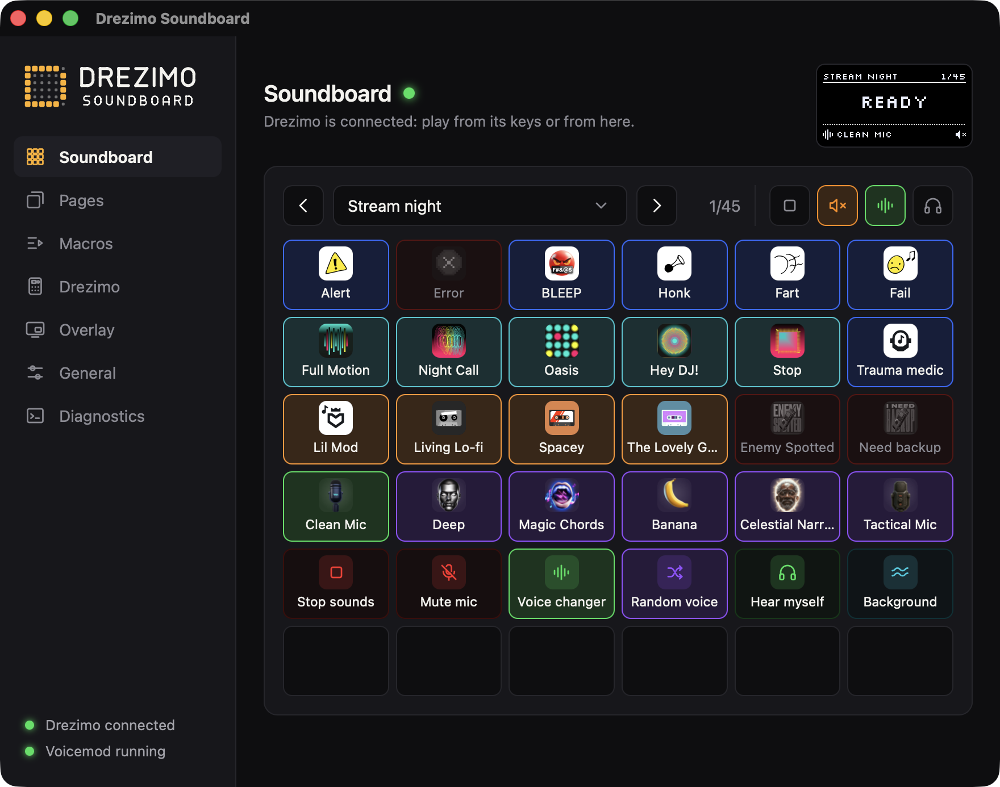
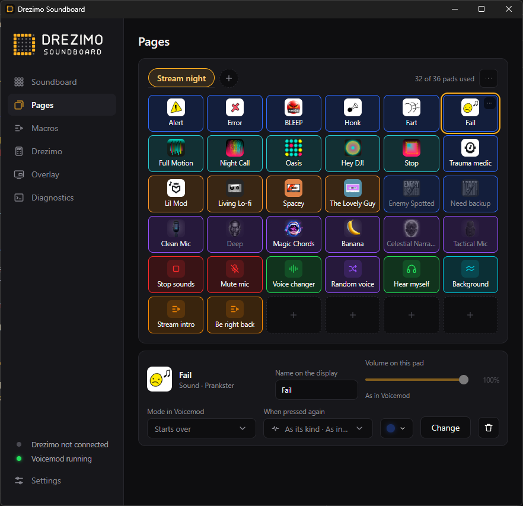
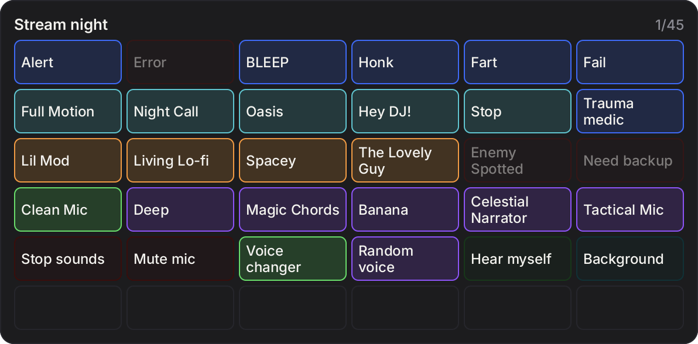

<h1>
  <picture>
    <source media="(prefers-color-scheme: dark)" srcset="assets/logo/drezimo-logo-dark.svg">
    
  </picture>
</h1>

A physical soundboard for [Voicemod](https://www.voicemod.net/): 36 pads, 6 function keys, a rotary encoder and a small OLED display, connected to the PC with a single USB cable.

**Status:** work in progress. The PCB (v0.2) is designed and ordered. The firmware implements the board ↔ app protocol and runs on a bare RP2040-Zero with the real display; the keys and LEDs wait for the PCB. The desktop app runs on Windows and macOS; on Windows it comes with an installer and keeps itself and the board's firmware up to date.

<p align="center">
  
</p>

## Hardware

- RP2040-Zero (RP2040, USB-C)
- 6×6 sound pads + 6 function keys, MX switches soldered to the PCB, 7×6 diode matrix
- 42 SK6812MINI-E reverse-mount RGB LEDs, one per key
- 1.3" SH1106 OLED (I²C) and an EC11 encoder with push button
- Custom 2-layer PCB, 3D-printed enclosure
- Powered from USB only

## The app

- **Soundboard:** the board's current page in the window, with Voicemod's pictures and the LEDs' live colours, playable from there too, and the display's live picture. Voicemod's soundboards and voices come as pages of 36 pads; a sound outside the Voicemod licence blinks red with "PRO ONLY" when pressed.
- **Your own pages:** sounds, voices and actions (stop the sounds, mute the microphone, the voice changer, a random voice, hear myself, mute for me, background effects, go to a page) in the order you want, with your own names and LED colours, before Voicemod's soundboards on the board.
- **Macros:** one pad playing a sequence of sounds, waits, voices and switches.
- **PC overlay:** the page's sounds on top of the other windows when the page changes or the knob is held, on the screen and in the corner you choose.
- **Updates:** the app updates itself and the board's firmware, and says what is new.
- **Support:** a report to copy, without personal paths, and a hardware test for a board just built.
- In English and Italian.

<table>
  <tr>
    <td width="58%"></td>
    <td width="42%"></td>
  </tr>
  <tr>
    <td align="center"><sub>The page editor</sub></td>
    <td align="center"><sub>The PC overlay</sub></td>
  </tr>
</table>

## Installing the app

Download the Windows installer (`-setup.exe`) from [Releases](https://github.com/ontech7/drezimo-soundboard/releases). It needs Voicemod, free or PRO, on the same PC. The app then starts with Windows, in the notification area, and keeps itself and the board's firmware up to date. The installer is not code-signed: at the first install Windows asks to confirm an unknown publisher (More info → Run anyway).

There is no macOS installer yet: build the app from source (below).

## How it works

The board talks to a desktop bridge app over USB. The app controls Voicemod through its Control API and reads Voicemod's log to know which sounds are actually playing, so the LEDs and the display match Voicemod's own soundboard. The app draws the display's pictures and the board shows them, so the texts are translated in the app.

## Repository layout

| Path | Contents |
|---|---|
| `hardware/scripts/` | Python scripts that generate the KiCad schematic and PCB, check the design and export review documents and fab files |
| `hardware/pcb/` | KiCad 10 project, generated by the scripts |
| `firmware/` | RP2040-Zero firmware (Arduino core for RP2040, built with `arduino-cli`) |
| `app/` | Bridge app for macOS and Windows (Tauri 2: Rust core, React settings window) |
| `hardware/lib/` | Project symbol and footprints (RP2040-Zero, MX switch, logo silkscreen) |
| `assets/logo/` | Logo (SVG) and app icon |
| `simulator/dummy-board.html` | 1:1 browser simulator of the board; can connect to Voicemod |
| `tools/` | Voicemod API probe, log watcher and behaviour experiments |
| `docs/` | Design notes and decisions (`project.md`), screenshots |

## Building the hardware files

Requires KiCad 10. On macOS:

```sh
cd hardware/scripts
python3 build_schematic.py
python3 check_design.py
/Applications/KiCad/KiCad.app/Contents/Frameworks/Python.framework/Versions/Current/bin/python3 build_pcb.py
python3 export_docs.py   # schematic PDF, 1:1 fit-check PDFs, 3D renders, DRC report in hardware/docs/
/Applications/KiCad/KiCad.app/Contents/Frameworks/Python.framework/Versions/Current/bin/python3 export_fab.py
```

`build_pcb.py` and `export_fab.py` need KiCad's bundled Python, which provides the `pcbnew` module. Edit the scripts, not the generated KiCad files.

`export_fab.py` writes the JLCPCB package to `hardware/fab/`: the Gerber + drill zip, the assembly BOM with LCSC part numbers and the placement file (CPL). All assembled parts are on the bottom side; the SK6812MINI-E is a JLCPCB "Standard PCBA only" part. The switches, the RP2040-Zero, the SN74AHCT125N, the OLED module and the encoder are hand-soldered.

## Building the firmware

Requires [`arduino-cli`](https://arduino.github.io/arduino-cli/) (`brew install arduino-cli` on macOS). The core and library versions are pinned in `firmware/drezimo/sketch.yaml` and downloaded on the first build.

```sh
./firmware/upload.sh          # build, then upload to the connected board
./firmware/build.sh --bundle  # build, then put the firmware into the app
```

The script works with the firmware running (it sends `BOOT` to reach the bootloader) or with the board already in bootloader mode: a blank module, or one plugged in while holding BOOT. It uploads with `picotool`; on macOS, copying the `.uf2` onto the RPI-RP2 drive can hang. It also sets the name the PC shows for the device: **Drezimo Soundboard**.

The app carries the firmware (`app/src-tauri/firmware/drezimo-<version>.uf2`) and updates every board with an older one as soon as it connects. After changing the firmware, raise `FIRMWARE_VERSION` in `firmware/drezimo/drezimo.ino` and run `build.sh --bundle`; the app's build stops while the two versions differ.

## Building the app

Requires [Rust](https://rustup.rs/), Node.js and Yarn 1, plus Tauri's [system prerequisites](https://v2.tauri.app/start/prerequisites/).

```sh
cd app
yarn install
yarn tauri dev     # run with live reload; the app lives in the menu bar / notification area
yarn tauri build   # installer for the current platform
cd src-tauri && cargo test
```

The Voicemod client key is built into the app. Request your own at [control-api.voicemod.net](https://control-api.voicemod.net/), then copy `.env.example` to `.env` at the repository root (git ignores it) and set `VOICEMOD_CLIENT_KEY`, or set it in the environment. Without it the app builds and runs, but cannot reach Voicemod.

A build made this way does not update itself: only the published ones do. To publish a version, raise `version` in `app/src-tauri/tauri.conf.json`, bring it to `main` and run **Actions → Release**, with what is new in one short line in its **notes** field, if anything: the installed apps show it once they have updated. The workflow needs three repository secrets: `VOICEMOD_CLIENT_KEY`, and the updater's private key and password as `TAURI_SIGNING_PRIVATE_KEY` and `TAURI_SIGNING_PRIVATE_KEY_PASSWORD` (made with `yarn tauri signer generate`; the public key is in `tauri.conf.json`).

Close the simulator page before running the app: only one program at a time can hold the board's serial port.

## Tools

```sh
pip install -r requirements.txt
python tools/voicemod_log_bridge.py   # live playback state on ws://localhost:59200
```

Open `simulator/dummy-board.html` in a browser to try the board without hardware.

## License

- Everything but the hardware design (the app, firmware, simulator, tools, `hardware/scripts/`, logo and docs): [MIT](LICENSE).
- Hardware design (`hardware/pcb/`, `hardware/lib/`, and the enclosure once added): [CERN-OHL-P-2.0](hardware/LICENSE).
- Fonts: Silkscreen on the display and Inter in the PC overlay, both under the SIL Open Font License, with their licences in `app/src-tauri/src/display/` and `app/src-tauri/src/overlay/`.
- The firmware image in `app/src-tauri/firmware/` is built from `firmware/` with the Arduino core for RP2040 (LGPL-2.1) and the libraries pinned in `firmware/drezimo/sketch.yaml` (Adafruit NeoPixel, LGPL-3.0; U8g2, BSD-2-Clause).

Voicemod is a trademark of its owner. This project is independent and not affiliated with Voicemod.
